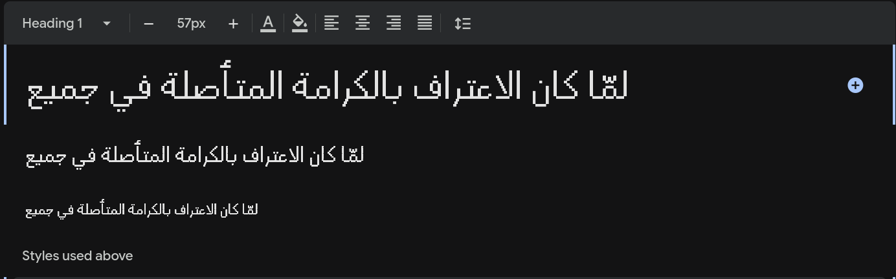

I've been working on an OCR model for historical Arabic manuscripts, and one major challenge is that the scripts look very different from modern digital fonts.

To build a good training dataset, I needed to know which fonts most closely match the handwriting style in these old books.

Most online font detection tools failed completely, so I came up with a simple matching pipeline:

1. Take a sample from an existing dataset that includes both page images and their text references
2. Download ~300 Arabic fonts (e.g. via Google Fonts API)
3. For each page image, render the same text using every font, at the same image size
4. Embed all images using DINOv3 and store them in Qdrant
5. Run a similarity search: the closest matches reveal which fonts look most like the original

## The Arabic Fonts

And it worked! The results across 100 pages:

- **Reem Kufi Ink Regular**: 93 pages (93%)
- **Handjet**: 6 pages (6%)

With the dominant font identified, I can now generate a large synthetic dataset of (image, text) pairs, giving the OCR model clean, labeled training data.

## **Reem Kufi Ink Regular**

## Handjet: 6/100 pages (6%)

### References

1. [Vector Database Book](https://kareemai.com/blog/posts/nlp/embedding_world/vector_database_book.html)
2. [Latest TTS Architecture](https://kareemai.com/blog/posts/nlp/TTS%20Architecture%20V1.html)
3. [Diversifying Search Results](https://kareemai.com/blog/posts/minishlab/pyversity_qdrant.html)
4. [Qdrant](https://qdrant.tech/)
5. [Dinov3](https://ai.meta.com/research/dinov3/)
