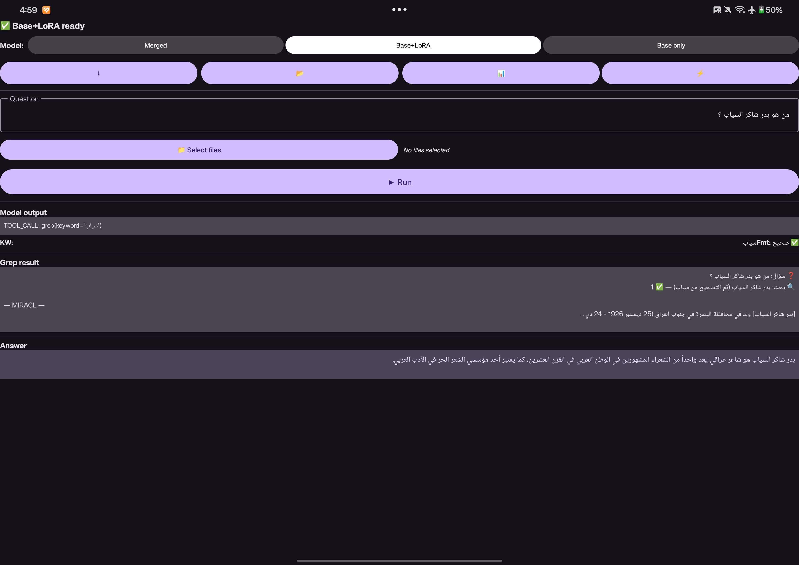

## What is Tool Calling or Function Calling?

**[Tool Calling](https://www.ibm.com/think/topics/tool-calling)** : it's ability of AI models to interact with external tools, APIs or Systems to enhance their functions.
They are the key for agentic AI.
It allows autonomous systems to complete complex tasks be decrease the work overload from the llm to be the llm with the tools like solutions.

You could think it's like a toolkit you give it to the carpenter instead of just the saw it has a whole toolkit that can :

1. Call databases
2. Run CLI tools like grep..etc

**It shifts LLms from passive assistants into proactive digital agents**

## Why Gemma 3 for Arabic?

Gemma 3 stands out for three reasons when working with Arabic:

1. **Multilingual training** : Google trained on diverse Arabic web text, not just English unlike qwen models thay are better at coding but not arabic langauge.
2. **Efficiency** : 1B parameters run fast even on limited hardware (critical for accessibility) I am using it on my amd cpu :)

The 1B variant is particularly interesting: small enough to fine-tune on a single GPU, yet capable of learning structured outputs like tool calls.

## Arabic Tool Calling with gemma

My goal is to fine-tune a gemma model to be good at on-device application and be able to use grep efficiently without the need for Embedding models and Rag systems.

We know that Arabic search tools struggle with:

- **Morphological complexity** — Arabic words have many forms (كتب، يكتب، كاتب، مكتوب)
- **Dialect diversity** — Modern Standard Arabic vs. regional variations
- **Resource scarcity** — Less training data than English

Our approach: teach the model to extract keywords and delegate to `grep`, a battle-tested tool that handles Arabic text well.

This shifts the burden from the LLM (which might hallucinate) to proven infrastructure.

## Building Training Data

We started with [MIRACL](https://github.com/project-miracl/miracl), a multilingual retrieval benchmark with Arabic passages and questions.

But we needed tool-calling examples.

Our approach was simple but effective:

1. Take the human-written queries from MIRACL
2. For each query, identify a single keyword that would find the relevant passage via `grep` with its variants.

> [!example] Arabic Tool calling Training
> من هو بدر شاكر السياب
> output :
> [بدر ، شاكر ، السياب ، سياب ، بدر شاكر]
> This is done using a DSPy programm and _gemini-3-flash-preview_

3. Format as Gemma 3 chat: user query → assistant tool call
   This gave us 6,217 synthetic (query, keyword) pairs for training without manual annotation.

_This is done with just a python code script._

## **Evaluation Reality**

We built a 96-question test set from SILMA.

Our metric was simple: does `grep(keyword="...")` find the correct document? When everything returned 0%, we debugged.

The issue wasn't the model architecture , it was format consistency.

## Learned Lessons

1. Don't fine-tune the whole model on just toolcalling after 2000 samples or more it will start losing it's ability to answer normal question. 

I will share the code and the results soon!

For more on retrieval without embeddings, see [Late Interaction & ColPali](/blog/posts/nlp/embedding_world/late_interaction.html) and [BM25 Arabic Search with Qdrant](/blog/posts/nlp/embedding_world/sparse_embedding/bm25_arabic_qdrant.html). Also check out my [CV of Failures](/blog/posts/ml_life/cv_of_failure.html) for the lessons learned along the way.
