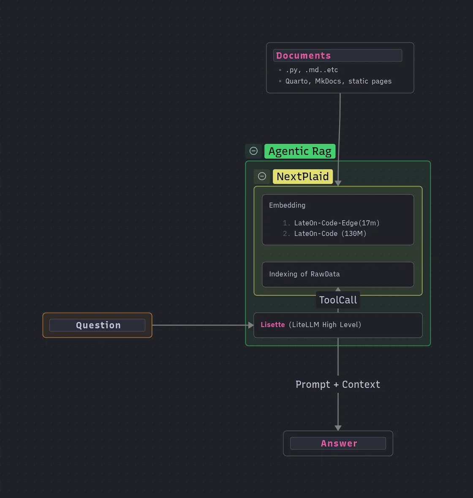

# عبدالكريم الخطيب

باحث في معالجة اللغة العربية ومهندس ذكاء اصطناعي

أبني نماذج ذكاء اصطناعي تفهم العربية وتعمل بكفاءة على الأجهزة محدودة الموارد، من نماذج التضمين والبحث الدلالي إلى أنظمة الصوت والتطبيقات الإنتاجية.

📞 +20 101 364 6887 ✉️ kareem01095134688@gmail.com

[جيت‌هاب](https://github.com/abdelkareemkobo) [لينكد إن](https://www.linkedin.com/in/abdelkareem-elkhateb-202b6b377/) [جوجل سكولار](https://scholar.google.com/citations?user=lF1wxvcAAAAJ) [إكس / تويتر](https://x.com/AbdelkareemElk1) [GPUVec](https://gpuvec.com)

ما أعمل عليه

يركّز عملي على معالجة اللغة العربية وبناء نماذج أصغر وأسرع يمكن تشغيلها خارج الخوادم الضخمة.

أدرّب نماذج تضمين عربية، وأجرّب المشفّرات الذاتية المتناثرة، وأطوّر أنظمة بحث دلالي وRAG للاستخدام الفعلي.

وأتابع دراسة الماجستير في تحسين كفاءة المحولات عند معالجة النصوص العربية.

[الخبرات، التعليم والسيرة المهنية ←](/about.html)

## أبحاث في معالجة اللغة العربية

### نماذج التضمين العربية

#### BertHash-Femto

أصغر 113 مرة من AraBERTv2، بدقة 94%. محول عربي يعمل على الأجهزة الطرفية. أبحاث كفاءة في ضغط نماذج معالجة اللغة العربية.

[→ GitHub](https://github.com/abdelkareemkobo)

#### Zarra & Bojji

نماذج لغوية عربية صغيرة محسّنة للنشر على الأجهزة المحمولة والطرفية. جزء من أبحاث كفاءة معالجة اللغة العربية المستمرة.

[→ اقرأ المزيد](https://kareemai.com/blog/posts/minishlab/blog_zaraah.html)

### نماذج الرؤية واللغة للعربية

#### Qari-OCR

أحدث نظام OCR عربي باستخدام تكيف نماذج اللغة متعددة الوسائط. WER 0.160, CER 0.061 على النصوص العربية المشكولة. منشور في arXiv 2025.

[→ الورقة البحثية](https://arxiv.org/abs/2506.02295) · [→ GitHub](https://github.com/abdelkareemkobo)

#### Arabic ColPali

نموذج رؤية-لغة لاسترجاع المستندات العربية باستخدام بنية ColPali.

[→ HuggingFace](https://huggingface.co/Abdelkareem/arabic_colpali)

### الكلام والصوت

#### Ara-Nemotron 3.5 ASR

تعرف على الكلام العربي بالبث المباشر للنسخ الفوري. يدعم لهجات عربية متعددة.

[→ HuggingFace](https://huggingface.co/Abdelkareem/Ara-nemotron-3.5-asr-streaming-0.6b)

#### Arabic TTS

بناء نموذج تحويل النص إلى كلام عربي من الصفر يستهدف جميع اللهجات الرئيسية. *قيد التطوير.*

### الوكلاء الأذكياء واستخدام الأدوات

#### Gemma3 Arabic Tool Calling

ضبط نموذج Gemma 3 لاستدعاء الأدوات بالعربية. نهج بدون RAG يُعلّم النموذج استدعاء الأدوات مباشرة بالعربية.

[→ HuggingFace](https://huggingface.co/Abdelkareem/gemma3-ar-toolcall-best-gguf)

## أدوات ومنصات

#### GPUVec

منصة مقارنة أسعار وحدات معالجة الرسوميات واختبارات أداء التعلم الآلي.

[→ اطّلع عليه](https://gpuvec.com)

#### SEO Rat

أداة تحليل SEO مفتوحة المصدر للمواقع الثابتة باستخدام بيانات Google Search Console.

[→ GitHub](https://github.com/abdelkareemkobo/seo_rat)

## أبرز المقالات في NLP العربية والذكاء الاصطناعي

#### [ضبط Gemma 3 لاستدعاء الأدوات بالعربية](/blog/posts/nlp/gemma_tool_calling.html)

نهج بدون RAG لتعليم Gemma 3 استدعاء الأدوات بالعربية — استخراج الكلمات المفتاحية، والبحث باستخدام grep، وبناء بيانات تدريب باستخدام MIRACL.

#### [HyperRun + ColGrep: بديل مستضاف ذاتياً لـ RunLLM](/blog/posts/nlp/embedding_world/hyperrun.html)

أضف أداة الدردشة “اسأل الذكاء الاصطناعي” لأي موقع توثيق باستخدام ColGrep للبحث الدلالي للكود و FastHTML.

[عرض جميع المقالات ←](/blog/feed.html) · [سلسلة التضمين ←](/blog/posts/nlp/embedding_world/index.html)

> فقالَ: إن تَصدُقِ اللَّهَ يَصدُقْكَ
